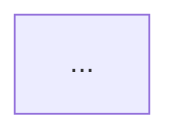

# Audience-Specific Output Formats

This reference defines the four output structures for `baw-project-doc`.
Select the structure that matches the audience the user chose at startup.

---

## 1. Executive Summary

**Intended reader:** Business stakeholder, executive, or product owner who needs to understand what the application does and why it exists — not how it is built.

**Tone:** Plain business English. No implementation terminology. No Mermaid step diagrams. No service internals.

**Output file path:**
```
docs/baw/<AppName>/<AppName>-executive-summary.md
```

**Document structure:**

```
# <Application Name> — Executive Summary

**Prepared:** <date>
**Source:** <filename>

## Table of Contents
...

---

## 1. Business Purpose
One to two paragraphs: what business problem does this application solve, who uses it,
and what outcome does it deliver. Written entirely in plain language — no acronyms,
no system names.

---

## 2. Process Overview
A high-level narrative of how the process works from a business perspective.
Include the key human roles and major decision points in prose form — not a table.
Do NOT include a Mermaid diagram. Do NOT list technical steps.

---

## 3. Key Roles
| Role | Responsibility in this Process |
|---|---|
| <Role Name> | <What they do — one sentence> |

---

## 4. Business Data
Names and plain-English descriptions of the main business data objects handled
by this process (e.g. "Requisition — the job opening request submitted by a manager").
Do NOT include field-level detail.

---

## 5. External Systems
A plain-English list of any external systems this process interacts with and why
(e.g. "HR database — used to look up employee information").
No technical endpoint detail.

---

## 6. Notable Constraints or Risks
Any business-relevant limitations, compliance requirements, or known gaps that a
stakeholder should be aware of.
```

**Chat summary tone:** Lead with the business outcome. One paragraph describing the process in terms a non-technical executive would understand. Omit all technical detail.

---

## 2. Knowledge Transfer (KT)

**Intended reader:** Developer or team inheriting ownership of this application who needs enough detail to maintain, extend, and troubleshoot it.

**Tone:** Developer-focused. Include implementation details, caveats, known quirks, and guidance for a new maintainer.

**Output file path:**
```
docs/baw/<AppName>/<AppName>-kt-guide.md
```

**Document structure:**

```
# <Application Name> — Knowledge Transfer Guide

**Prepared:** <date>
**Source:** <filename>
**Snapshot:** <snapshot label or branch ID>

## Table of Contents
...

---

## 1. Application Overview
Brief description: what the app does, who commissioned it, known constraints.
Toolkit dependencies with version notes.

---

## 2. Architecture & Entry Points
How the application is invoked (start event type, exposed REST/SOAP operations).
Environment variable sets and their purpose.

---

## 3. Processes

### 3.x <Process Name>
**Description:** ...
**Swimlanes / Participants:** (table)

#### Step-by-Step Walkthrough
Narrative walkthrough — not just a table. For each significant step, explain:
- What triggers it
- What the performer needs to do or decide
- What data it reads or writes
- Any known quirks, edge cases, or historical context a new developer should know

#### Process Flow Diagram


#### Steps Table
(same format as Technical Reference)

#### Timers & Boundary Events
(same as Technical Reference — include developer notes on what to watch for)

#### Process Variables
(same as Technical Reference)

---

## 4. Services

### 4.x <Service Name> (<type>)
(same detail as Technical Reference)

#### Developer Notes
Any implementation caveats, retry logic, known failures, or maintenance tips.

---

## 5. Business Objects
(same as Technical Reference)

---

## 6. Coach Views / Widgets
(same as Technical Reference)

---

## 7. Integration Points
(same as Technical Reference — add notes on authentication, error handling, or known issues)

---

## 8. Developer Onboarding Checklist
A short checklist of things a new developer should verify or set up before working
on this application:
- [ ] Confirm environment variables are configured in target environment
- [ ] Validate all integration endpoints are reachable
- [ ] Review open items in Section 9

---

## 9. Known Issues & Improvement Notes
Unresolved gaps, technical debt, or areas flagged during analysis that the incoming
team should be aware of.
```

**Chat summary tone:** Highlight what a new developer most needs to know — key quirks, integration dependencies, and any gaps. Practical, not ceremonial.

---

## 3. Partner Handoff

**Intended reader:** External partner or client receiving ownership or a copy of the application. Needs both a clear understanding of what they are receiving and actionable guidance on what could be improved.

**Tone:** Professional and accessible. Mix of business context and light technical overview. Include a dedicated improvement recommendations section.

**Output file path:**
```
docs/baw/<AppName>/<AppName>-partner-handoff.md
```

**Document structure:**

```
# <Application Name> — Partner Handoff Document

**Prepared:** <date>
**Handoff Source:** <filename>
**Snapshot:** <snapshot label or branch ID>

## Table of Contents
...

---

## 1. Application Overview
What the application does, who it was built for, and what business need it addresses.
Toolkit dependencies listed.

---

## 2. Process Inventory
A table of every process in the application with a one-sentence description:
| Process | Type | Description |
|---|---|---|

---

## 3. Process Details

### 3.x <Process Name>
Brief narrative of what the process does.

#### Process Flow


#### Key Roles and Responsibilities
| Role | Responsibility |
|---|---|

#### Process Variables
(same as Technical Reference)

---

## 4. Services Summary
| Service | Type | Purpose |
|---|---|---|
(One row per service — concise)

---

## 5. Business Objects
(same as Technical Reference)

---

## 6. Integration Points
(same as Technical Reference)

---

## 7. Improvement Recommendations
Concrete, actionable recommendations identified during analysis. Each item should
explain the current state, the problem or opportunity, and a suggested approach.

| # | Area | Current State | Issue / Opportunity | Recommendation |
|---|---|---|---|---|
| 1 | <area> | <what exists now> | <why it matters> | <what to do> |

Sources for recommendations: missing descriptions, hardcoded values that should be
environment variables, undocumented integration endpoints, processes with no error
handling, overly complex flows that could be simplified, deprecated service types.

---

## 8. Assumptions & Gaps
(same as Technical Reference)
```

**Chat summary tone:** Briefly describe what is being handed off, then call out the top improvement opportunities clearly. End with a count of total recommendations.

---

## 4. Technical Reference

**Intended reader:** Developer, architect, or technical lead who needs a complete and precise technical record of the application.

**Tone:** Technical and complete. No content is omitted to aid readability.

**Output file path:**
```
docs/baw/<AppName>/<AppName>-documentation.md
```

**Document structure:** Follow `DOCUMENTATION_OUTPUT.md` exactly. This is the existing format — no changes.

**Chat summary tone:** Follow the existing Step 4 chat summary format in `SKILL.md` exactly — Mermaid flow, services table, coach views table, notable gaps.
